# CANAL 404

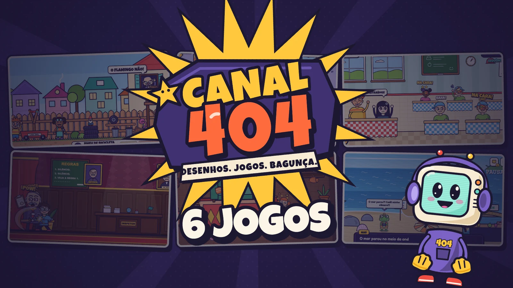

A fictional game portal inspired by the feel of 2000s cartoon-channel websites. The channel went off the air, but the portal still works: an illustrated, interactive broadcast room, original characters, hidden secrets and six complete games: **Rua Sem Saída**, **Laboratório de Péssimas Ideias**, **Guerra de Lanche**, **Operação: Recreio**, **Guerra do Pijama** and **Férias Fora do Ar**.

The code, file names and ids are in English. Everything the visitor reads on screen is in Brazilian Portuguese.

## Screenshots

### The portal

<table>
  <tr>
    <td width="50%">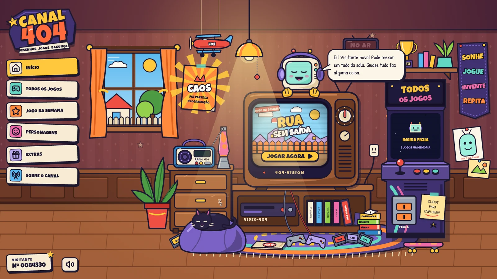</td>
    <td width="50%">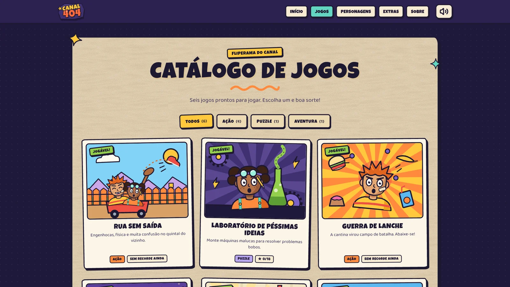</td>
  </tr>
  <tr>
    <td align="center">Broadcast room (<code>/</code>)</td>
    <td align="center">Game catalog (<code>/games</code>)</td>
  </tr>
  <tr>
    <td width="50%">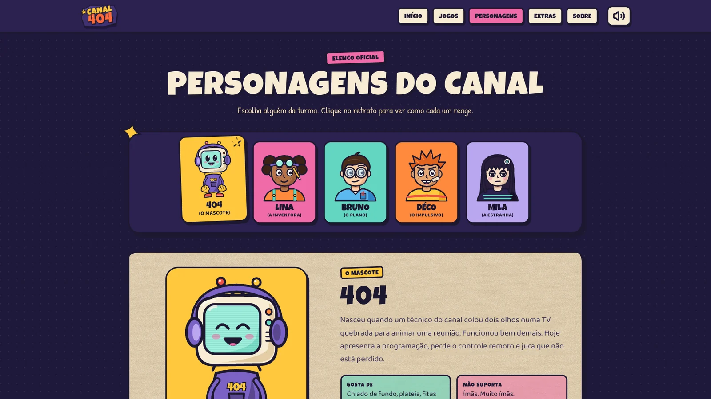</td>
    <td width="50%">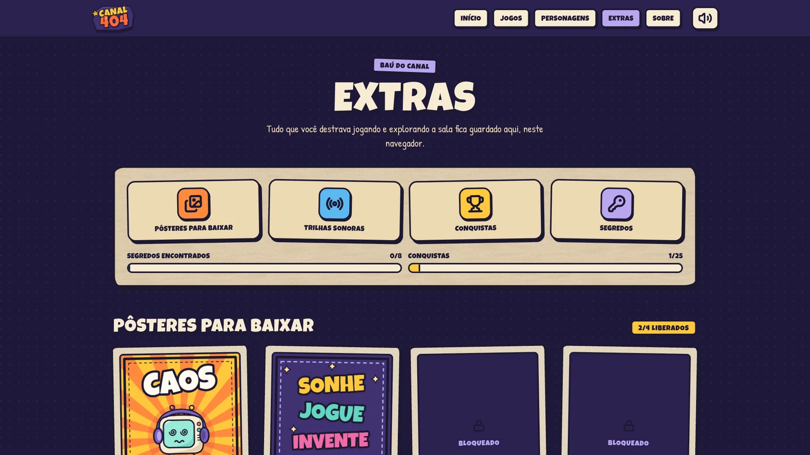</td>
  </tr>
  <tr>
    <td align="center">Characters (<code>/characters</code>)</td>
    <td align="center">Extras (<code>/extras</code>)</td>
  </tr>
</table>

### The games

<table>
  <tr>
    <td width="33%">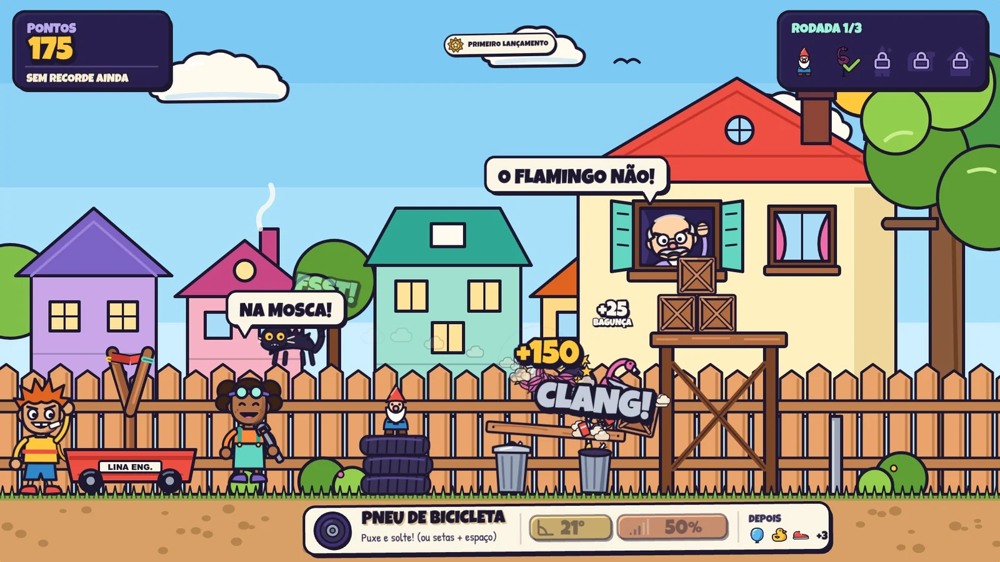</td>
    <td width="33%">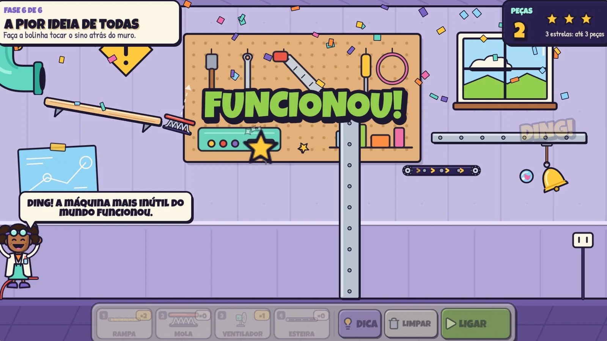</td>
    <td width="33%">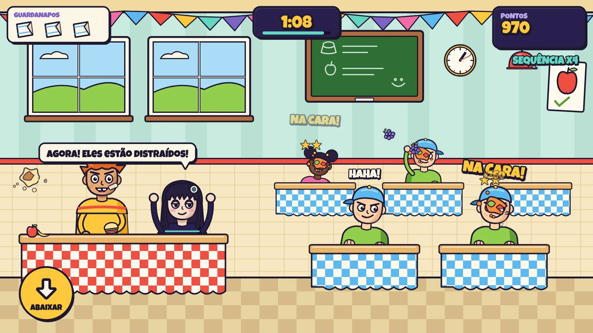</td>
  </tr>
  <tr>
    <td align="center"><b>Rua Sem Saída</b></td>
    <td align="center"><b>Laboratório de Péssimas Ideias</b></td>
    <td align="center"><b>Guerra de Lanche</b></td>
  </tr>
  <tr>
    <td width="33%">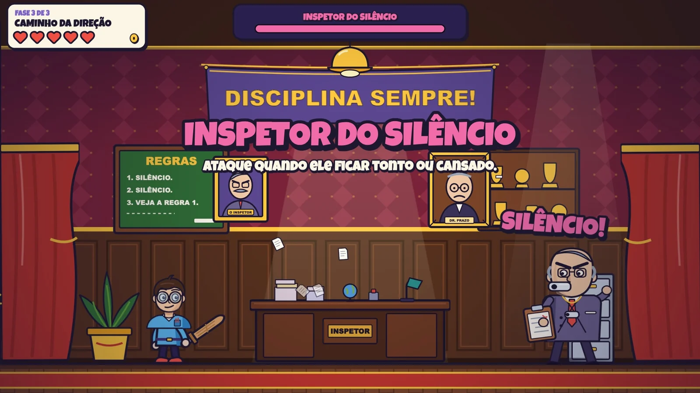</td>
    <td width="33%">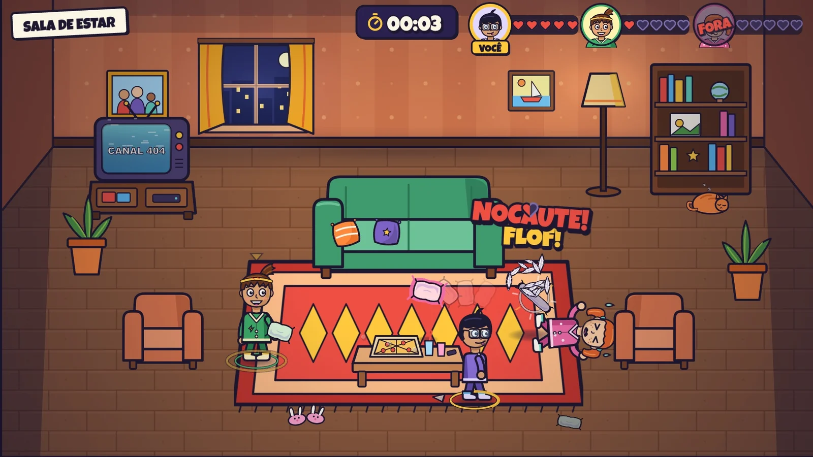</td>
    <td width="33%">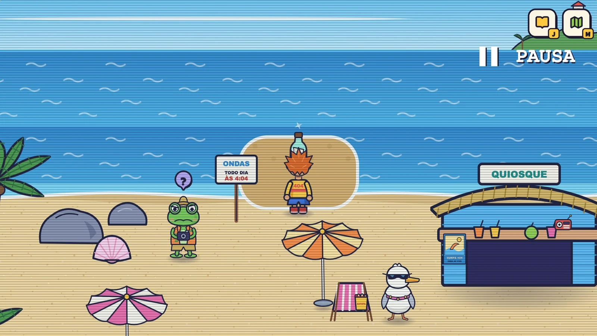</td>
  </tr>
  <tr>
    <td align="center"><b>Operação: Recreio</b></td>
    <td align="center"><b>Guerra do Pijama</b></td>
    <td align="center"><b>Férias Fora do Ar</b></td>
  </tr>
</table>

## Running

```bash
npm install
npm run dev
```

Open `http://localhost:3000`. For a production build:

```bash
npm run build && npm start
```

There are no external services, sign-ins or API keys. Progress, high scores, secrets and preferences live in the browser's `localStorage` (key `canal404:progress:v1`).

## Stack

- Next.js (App Router) + React + TypeScript
- Tailwind CSS 4 (color, font and texture tokens in `src/app/globals.css`)
- Phaser 3 for the games, loaded on demand only on the play page (Matter.js physics for Rua Sem Saída and the Laboratório)
- Motion for interface micro-interactions
- Lucide icons (`lucide-react` in the portal, Lucide icon nodes rendered to textures inside the games)
- Hand-made SVG for every illustration
- Web Audio API for sound effects and live-synthesized music

## Routes

| Route | Content |
| --- | --- |
| `/` | Broadcast room: TV with the game of the week and channels, arcade cabinet that opens the catalog, radio with music, the 404 mascot and objects hiding secrets |
| `/games` | Catalog with category filters |
| `/games/[slug]` | Game page (playable or "off the air") |
| `/play/[slug]` | Real loading screen, intro, match, pause and results |
| `/characters` | Character select with reactions |
| `/extras` | Downloadable posters (PNG), music, achievements and secrets |
| `/about` | The channel's fictional history |

Game slugs: `dead-end-street` (Rua Sem Saída), `bad-ideas-lab` (Laboratório de Péssimas Ideias), `food-fight` (Guerra de Lanche), `operation-recess` (Operação: Recreio), `pajama-war` (Guerra do Pijama) and `off-air-vacation` (Férias Fora do Ar).

## Structure

```
src/
  app/                   routes (App Router); (sections) groups the pages with the site chrome
  components/
    room/                broadcast room, objects and mascot director
    mascot/              404 mascot (expressions, poses, gaze)
    characters/          characters and the select screen
    catalog/             game cards and catalog
    game-shell/          loading, intro/pause/result panels and the bridge to the game
    extras/              posters, jukebox, achievements and secrets
    art/                 logo, covers, game logos, icons and badges
    layout/              navigation, toasts, sound
    ui/                  visual primitives
  games/
    registry.ts          metadata for every game (catalog)
    loaders.ts           dynamic import for each playable game
    types.ts             contract between the portal and the games
    kit/                 shared Phaser helpers (cartoon text, panels, speech bubble, Lucide icons)
    dead-end-street/     slingshot game (Phaser scenes, waves, sounds)
    bad-ideas-lab/       machine puzzle (levels, geometry, scenes, sounds)
    food-fight/          cafeteria food fight (scenes, rivals, sounds)
    operation-recess/    side-scrolling action platformer (phases, hero, enemies, boss, sounds)
    pajama-war/          three-way pillow fight (arenas, fighters, AI, pillows, sounds)
  lib/
    audio/               Web Audio engine, effects and music
    progress/            persistence, secrets and achievements
public/assets/<slug>/    SVG art for each game
```

## Adding a game

Games are independent from the portal. Each one exports a `GameModule` with `mount(ctx)` and receives only what it needs from the portal (parent element, fonts, audio, current high score and progress/event callbacks).

1. Create `src/games/<slug>/` with an `index.ts` that exports `{ mount }` following `src/games/types.ts`.
2. Register the metadata in `src/games/registry.ts` (title, category, controls, how-to, `status: "available"`).
3. Add the loader in `src/games/loaders.ts`.
4. Draw the cover in `src/components/art/Covers.tsx` and the logo in `src/components/art/GameLogos.tsx`.

The portal handles loading with a real progress bar, the intro screen, pause, results, high scores, achievements and screen-reader announcements. Games with levels declare `levels` in the registry and return `level` in the result: the portal shows the level picker (each level unlocks the next), saves stars per level and offers "Próxima fase". A game can call its levels arenas (`levelWord`), list guest characters for the cast section (`guests`), and add one extra result button by returning `alt` in the result and implementing `alt()` (Guerra do Pijama uses it for "Trocar personagem"). Games that save their own progress declare `resumable` (their `localStorage` key): the intro then offers "Continuar aventura" and "Nova aventura" (with a confirmation), `start({ fresh: true })` starts over, and the result can rename its main button with `restartLabel`.

## Rua Sem Saída (`dead-end-street`)

A slingshot mounted on a wagon: pull back (mouse or touch) or use the arrow keys to aim and Space to launch. Three short rounds in Seu Arlindo's yard (close targets, then behind obstacles, then up high) with seven launches of four projectile types with different physics. The neighborhood reacts: the cat runs, the trash can lid flies, the bird escapes the birdhouse. Points per target, round, mess, combos and leftover ammo; the high score is saved locally.

## Laboratório de Péssimas Ideias (`bad-ideas-lab`)

A physics puzzle in Lina's garage. The first level is a quick test: one ramp, a dashed marker showing where it goes and an arrow on the LIGAR button. Then come five silly problems: wake the cat with the bell, press the toaster button, get an orange into the juicer, bring the ball back to the TV remote, and the worst idea of all.

Each level has a box of counted parts (ramps, springs, fans and conveyor belts) and a dashed build area. Parts can be dragged with mouse or finger, or placed with the keyboard: numbers pick, arrows move, R rotates, Enter places, Space runs the machine and H asks for a hint. When a run fails, the ball's path stays on screen, Lina reacts and, on the second failure, gives a hint. Stars depend on how many parts were used.

The levels were calibrated in simulation with the same physics rules as the game (`config.ts`, `levels.ts` and `geometry.ts`): each one has tested solutions, and single-part shortcuts don't work.

## Guerra de Lanche (`food-fight`)

A cafeteria food fight in 75-second rounds. Déco and Mila hide behind their table. Tap a kid from the rival class to throw a snack at them, and hold ABAIXAR when the exclamation mark appears so the pudding flies overhead. While ducked, Mila hands over more snacks. Three puddings use up the napkins; lasting until the bell rings is a win. Pimentinha throws fast, Grandão takes two hits, and the lunch lady, who walks by now and then, must not be hit.

The first match starts with a short practice: a rival waits for the first snack and the first pudding comes slowly, with Mila calling it out. On the keyboard, Space throws at the most dangerous rival, 1 to 5 pick a table and the down arrow ducks.

The round changes as it goes: after about 20 seconds some kids hide behind a lunch tray (wait until they lower it to throw), hitting a kid who is about to throw drops the pudding on his own head for a bonus, and around the middle of the round the rival tables start fighting each other for a few seconds (every hit counts double) until the lunch lady's whistle ends it. Incoming puddings have a red ring, and the lunch lady carries a "don't hit" marker.

## Operação: Recreio (`operation-recess`)

A side-scrolling action platformer. The school monitors cancelled recess, and Bruno grabs a cardboard sword to get it back. Arrows or A/D move, Space jumps (hold to jump higher) and J attacks; on touch screens there are left, right, jump and attack buttons. Movement uses coyote time and jump buffering, attacks have a short wind-up, an active slash window, a small lunge and a cooldown, and hits pause the action for a few frames.

Three phases: the forbidden corridor (common monitors, lockers, puddles), the occupied yard (whistle monitors whose sound waves can be jumped or slashed, balls bouncing out of a box, jungle gym platforms) and the way to the principal's office (shield monitors that block frontal hits, book carts over gaps, and the final fight). Every enemy shows an exclamation mark before attacking. Bruno has five hearts, snacks restore one, and bells work as checkpoints: losing after a bell restarts from it.

Each phase has its own layered set: the corridor (rows of lockers, classroom doors, windows to the yard, authoritarian posters, papers that blow when Bruno runs past), the yard (parallax buildings and trees, the court fence, a snack kiosk, bunting, protest signs) and the way to the office (columns, portraits of former principals, busts, banners, warmer light). Lockers, posters, bins and plants react to the sword. The camera zooms in on the action and opens up for the boss fight, with the HUD on its own camera.

The boss, the Inspetor do Silêncio, has three telegraphed attacks: a giant whistle wave to jump over, a charge that ends with him dizzy against the wall, and a clipboard slam that gets stuck. He blocks hits while guarding and can only be hit in those openings. Beating him frees recess and the kids celebrate.

## Guerra do Pijama (`pajama-war`)

A three-way pillow fight seen from above at a slight angle. The player picks Lia (faster), Nico (throws faster) or Bia (recovers faster) and fights the other two, who also fight each other. WASD or arrows move, the mouse aims, and a click or Space throws (holding keeps throwing; quick taps are queued so none get lost). On touch screens a joystick appears where the left thumb touches and the right side of the screen throws with automatic aim. Kids are drawn facing front, back and sideways (mirrored for left), with a four-step run cycle, a lean when speeding up or braking, and windup and throw poses that follow the aim, not the movement.

Aim: a short dotted line follows the real flight of the pillow at hand height and turns yellow when the next pillow is ready; an arrow at the player's feet shows the throw direction and a ring around them fills during the cooldown. With the mouse, aiming close to an opponent locks on (yellow ring and arrow on the target) and leads it slightly; without the mouse, Space and the touch button pick the closest opponent in front. Flying pillows have an outline in the thrower's color and a short trail, while floor pillows are muted. Hits show a ring, a word (POF!, PAF!, FLOF!, TUF!), a squashed pillow, a half heart falling off the target and a body reaction; a pillow that passes close shows UFA! (on the player) or QUASE! (on an opponent).

Each kid has five hearts (each hit takes half a heart). Energy comes back after a few seconds without getting hit. After 40 seconds the fight heats up and energy returns more slowly; after 70 seconds nobody recovers, so matches end in about one to one and a half minutes. Opponents pick targets by distance and recent hits, spread out so they don't both chase the player, keep a preferred distance, dodge some pillows and back off when low on energy. Last one standing wins.

Fairness rules for the player: an opponent about to throw at the player shows an orange ! during a longer windup (about 300 ms in the bedroom, 260 ms in the living room, 220 ms in the backyard); only one opponent attacks the player at a time, with a gap between attacks; after the player is hit there is a one-second break and 850 ms of invulnerability; opponent pillows fly a little slower than the player's; and in the first 15 seconds opponents throw at the player less often and less accurately.

Three arenas unlock in order: the bedroom (open floor, toys that react), the living room (sofa, TV and armchairs block pillows, cushions fall off the sofa, a cat wakes up and runs) and the backyard at night (tent, tree and grill as cover, tire swing, lanterns and fireflies). Wins per character are saved locally and shown on the character select.

## Férias Fora do Ar (`off-air-vacation`)

A top-down exploration adventure in the Canal 404 resort, which kept running after the channel went off the air. Déco explores five areas connected by paths (Recepção, Piscina, Fliperama, Praia and Floresta) plus two hidden rooms (the transmission room behind the waterfall and room 404). Arrows or WASD move, E, Space or Enter talk, examine and pick things up, J opens the journal and M the map. A click or tap walks to a spot (with pathfinding around obstacles) and talks to whoever is there; on touch screens a joystick appears under the left thumb and an action button shows the current verb.

The main quest is a chain of small puzzles, not fetch quests: the receptionist cat points to the lifeguard, the lifeguard's whistle hangs on a flamingo float out of reach (a leaf net from the shed solves it), the arcade machine Tilt only returns the master remote after the player beats its level-404 minigame (catch ten signals, avoid the static), the remote pauses the sea so a bottle with the final order appears in the wet sand, and pausing the waterfall reveals the transmission room. There the twist plays out on the monitors: the residents always knew, and nobody wanted to press the button. The player chooses to end the broadcast or keep it on air. Both endings lead to a pool party, and then the resort stays open for exploring.

Besides the main cast, a few residents make the resort feel lived in without handing out chores: Capivaldo runs the juice stand by the pool (a special juice that "rewinds" the moment, and gossip that follows the current quest step), Clique the frog tourist never gets the photo of the 4:04 wave (the master remote can pause the sea for him), Dr. Cavuca walks in circles in the forest with his map upside down, Chiadinho is a shy bit of TV static that peeks from behind trees and only comes closer when Déco stands still, and Placar, the arcade attendant, keeps the record board (which updates as the player progresses). Residents greet the player with short speech balloons when he gets close, and many objects react when examined: the flamingo float turns its head, the surfboards wobble like dominoes, a crab pops out of the sand castle, the mushrooms light up in sequence, the bridge reflects color bars, and the broken arcade cabinet spells out a clue about the waterfall.

Optional content: five lost Canal 404 posters (one per area), three golden tokens that wake a hidden machine behind the arcade curtain, the key carried by Seu Lento (a tortoise who walks the beach very slowly) that opens room 404, and Seu Lento himself, who only reaches the pool after the ending. Residents have idle animations, react while talking and get new lines as the story moves on. The journal shows the current main mission, side missions, discoveries, the collection and an island map with the player, the next objective and missing posters.

The world is split into areas loaded one at a time with a fade. Déco (about 220 px tall) is the scale reference: doors are around 270–290 px, counters and tables come up to his chest, palms are about 2.5 times his height, and a few props are rasterized at a larger scale in `BootScene` (`ART_SCALE`) so they stay sharp. Collision uses the player's feet against rectangles at the base of each object, circles for trunks and poles, and custom shapes (the sea, the stream, the waterfall pool); depth follows the y position, and tall props fade when the player walks behind them. The camera follows the player and, near a building or a point of interest, keeps its whole frame in view when it fits on screen (`frame()` in `areas.ts`). Exits are marked by paths, doors and doormats; a small arrow only appears when the player is close. Text follows one hierarchy: Luckiest Guy for titles, signs and name tags, and Fredoka (SemiBold for dialogs, Bold for prompts and small labels) everywhere else. The dialog box sizes itself to the text, wraps lines before typing so words never jump, shows the speaker's portrait and name, and tags objects with a short label ("TV", "Malas"). The interaction prompt names the object ("Examinar · TV"), only appears for the closest spot, avoids covering characters and marks the target with a soft ring on the floor.

Small ambient touches reinforce the broadcast theme: the lobby TV catches fragments of old Canal 404 shows, the broken arcade cabinet flashes ERRO 404, the beach kiosk radio picks up interrupted transmissions, the lighthouse blinks in groups of four, the antenna sends out signal waves, and a ghost peeks out of the ghost train arch now and then. Residents blink, the receptionist follows the player with his eyes, crabs run and hide when the player gets close, and fireflies, falling leaves and flickering lanterns keep the forest moving. Progress is saved automatically in `localStorage` (`canal404:off-air-vacation:v1`) on every area change, item and quest step, and every few seconds. A full playthrough was verified with a bot that walks with the game's own pathfinding and collision, plays every quest, secret and both endings, and reloads the page halfway to test "Continuar aventura".

## Accessibility

- Every object in the room is a real button or link, keyboard-reachable, with a visible focus ring.
- Hover hints also appear on focus; important actions don't depend on hover.
- The games accept keyboard, mouse and touch, and announce events through an `aria-live` region.
- `prefers-reduced-motion` is respected and nothing depends only on audio; sound starts only after an interaction and can be turned off.
